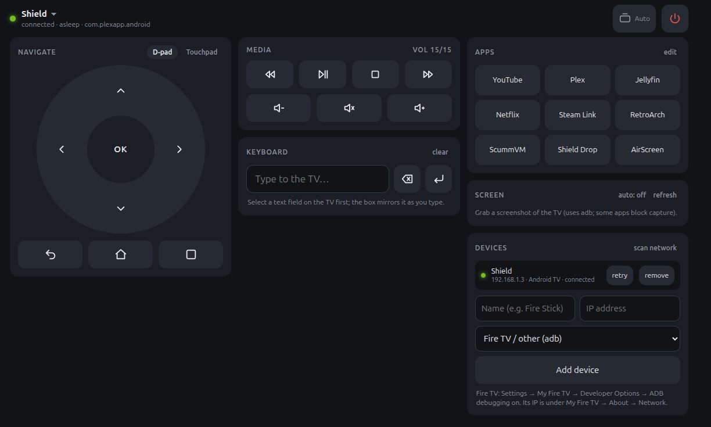

# shield-remote

A browser remote for the TV boxes on your LAN. Run it on any always-on machine, open the page
on a phone or laptop, and drive an NVIDIA Shield, a Google TV, or a Fire TV stick: one page
for all of them, with a device picker in the header.

- **Android TV / Google TV** (NVIDIA Shield, Chromecast with Google TV, Sony/TCL Google TVs):
  speaks the Android TV Remote protocol v2, the same one Google's TV phone app uses (TLS on
  6466, pairing code on 6467), via [androidtvremote2](https://github.com/tronikos/androidtvremote2).
  Live text input that mirrors the focused field on the TV, plus current app and volume.
- **adb** (Fire TV sticks, anything with network ADB): one persistent `adb shell` per device.
  Keys, long-press, text sent with `input text` on Enter (ASCII only), app launch by package
  or deep link.

Features: D-pad or swipe touchpad, long-press on OK/Back/Home, hold-to-repeat on arrows and
volume, media keys, live keyboard, an app launcher (package names or deep links, editable per
browser and per device), screenshot preview (needs adb on either kind), network scan, and
desktop keyboard shortcuts (arrows, Enter=OK, Esc/Backspace=Back, h=Home, space=play/pause,
+/-, m=mute). Portrait and landscape layouts.

## Run it

Needs Python 3.12+ and [uv](https://docs.astral.sh/uv/). `adb` (Android platform-tools) is
optional, for Fire TV control and screenshots; it is found on `PATH` or via `ADB=`.

    git clone https://github.com/jeang42/shield-remote && cd shield-remote
    uv run server.py            # then open http://<this host>:8780/

Add devices from the page (Devices → add, or "scan network", which probes your /24 for
ports 5555 and 6466). They are saved in `data/devices.json`.

- **Android TV / Google TV**: the page shows a pairing panel the first time. Press Start and
  type the code the TV shows. The client certificate and key are kept in `data/`; delete them
  to pair again.
- **Fire TV**: Settings → My Fire TV → Developer Options → ADB debugging on (if Developer
  Options is hidden, click the device name under About 7 times). Accept the "Allow
  debugging?" prompt on the TV when the remote first connects.

Settings are environment variables: `REMOTE_HOST` (default `0.0.0.0`), `REMOTE_PORT`
(default `8780`), `ADB` (path to adb), and `SHIELD_IP` (seeds one Android TV device on first
run, when `data/devices.json` doesn't exist yet).

## Security

There is no authentication. Anyone who can reach the port can drive your TVs, type into
them, and take screenshots. Keep it on a trusted LAN; don't expose it to the internet.

## Run as a service

`shield-remote.service` is a systemd user unit that assumes the repo lives at
`~/shield-remote` (edit the paths otherwise) and reads `remote.env`:

    uv sync
    cp shield-remote.service ~/.config/systemd/user/
    systemctl --user daemon-reload && systemctl --user enable --now shield-remote
    journalctl --user -u shield-remote -f

To keep it running while you're logged out: `loginctl enable-linger $USER`.

## Behind nginx

All page URLs (WebSocket, screenshots) are relative, so it works under a path prefix with no
rewriting. Set `REMOTE_HOST=127.0.0.1`, restart, and proxy:

    location = /remote { return 301 /remote/; }
    location /remote/ {
        proxy_pass http://127.0.0.1:8780/;
        proxy_http_version 1.1;
        proxy_set_header Upgrade $http_upgrade;
        proxy_set_header Connection "upgrade";
        proxy_set_header Host $host;
    }

The trailing slash on `/remote/` matters: the page resolves `ws` and `screenshot` against it.

## License

MIT
